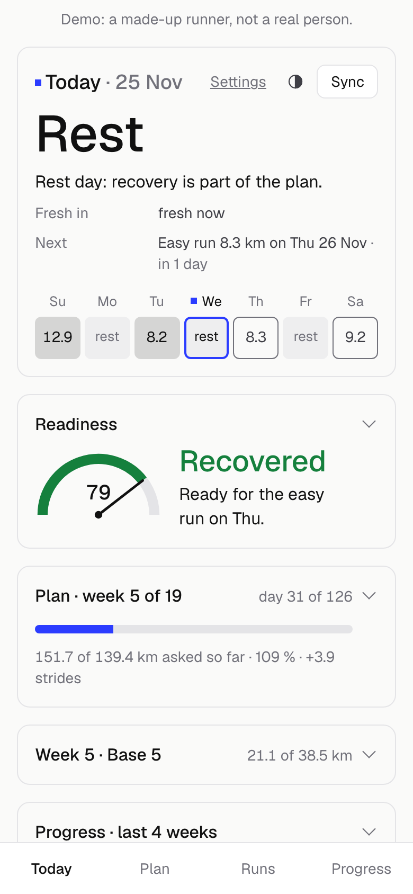
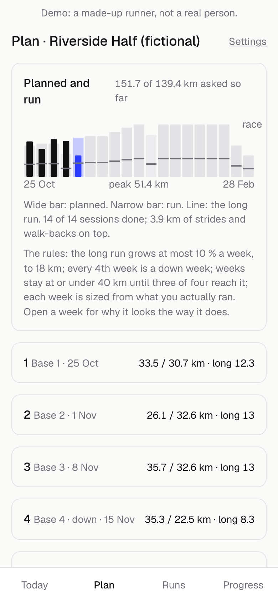
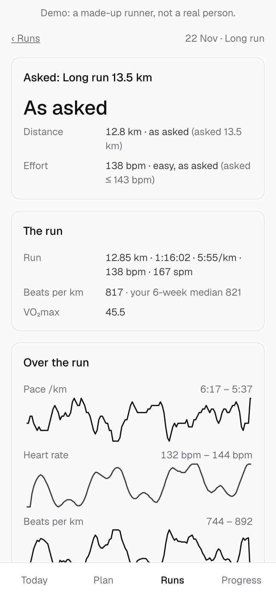

# Run Planner

My half-marathon plan, my runs from Runalyze, and my progress. One runner, one race, phone first.

Inspired by [Sparing Horse](https://github.com/dros74/sparinghorse) by Duarte Rosado (AGPL-3.0). No code or tuned parameters are taken from it; the rules below cite their published sources. The readiness score comes from my earlier [run-coach](https://github.com/Andrel666/run-coach).

| Today | Plan | A run |
|---|---|---|
|  |  |  |

*Screenshots from the demo: a made-up runner, not a real person.*

## Try it with the demo runner

```bash
npm install
npm run demo        # http://localhost:3200
```

`npm run demo` fills `demo.db` with a made-up runner (`demo/runner.mjs`): 38, 16 weeks of runs with heart rate, cadence and elevation, a down week every 4th week, a missed week with a cold, one session at half-marathon pace, and sleep, HRV and resting heart rate for every night. The data is generated from a fixed seed, so it is the same on every machine. No Runalyze token, no sign-in, nothing leaves your computer. The tests use the same runner.

## The problem

The earlier versions did too much. [run-coach](https://github.com/Andrel666/run-coach) had chat, generated plans, recovery, gait analysis and strength work, and a generated plan cannot show why a week has the size it has. What I needed each day was smaller: the session, whether I am ready for it, and whether the race goal still holds.

## Who it is for

One runner: me, building to one half marathon. Every rule below is tuned for that.

## How it got here

Before this, I used Sparing Horse, a self-hosted planner built on Runalyze, in my own fork. I added settings to protect my calves (a longest long run, a volume hold, when a fourth run joins) and a simpler interface. Then I wrote a small Next.js app of my own that runs free on Vercel, with every number either taken from a published source or labelled as my own choice, and moved my readiness score over from run-coach.

## Decisions

- **Rules instead of AI.** The plan is plain code with the rules in one table below. Each week shows every limit it was checked against and which one set its size.
- **The plan follows what was run.** Weeks already run are read from Runalyze, not from the plan, so a missed or short week lowers the next ones.
- **Narrow on purpose.** One race, one runner, four tabs. No chat, no video analysis, no strength library.
- **Free to run.** Vercel Hobby for the app and one daily sync, Turso for the database.

## What it shows

- **Today**: the session, readiness (a 0–100 score from sleep, HRV, resting HR and yesterday's load, ported from run-coach), this week, the race prediction.
- **Plan**: every week to race day, each sized from what was actually run.
- **Runs**: the log with beats per km; each run's debrief (an easy run that ends with strides is judged on its easy part).
- **Progress**: beats per km, VO₂max, weekly km, Runalyze's fitness and prediction.

## The plan's rules (`src/lib/engine/plan.ts`, `load.ts`, `zones.ts`)

Where a value has no published source it says "my choice". Those are untuned.

| Rule | Value | Source |
|---|---|---|
| Long-run step | at most +10 % over the longest of the last 4 weeks, never over the longest-run setting (18 km by default) | The "10 % rule", a coaching heuristic. A graded 10 % program did not lower injuries in novice runners (Buist et al. 2008, *Am J Sports Med*). Default length: my choice |
| Week step | at most +10 % over the biggest of the last 4 weeks | The same heuristic |
| Week shape | the long run is 40 % of a 3-run week, 35 % of a 4-run week | My choice |
| Load ratio | the week's mean fatigue over its mean fitness: over 1.3 the easy runs are trimmed, unless the week carries no more load than the last full week | Cap: Gabbett 2016 (*Br J Sports Med*), injury risk lowest at an acute:chronic ratio of 0.8 to 1.3. The exception: my choice |
| Fitness and fatigue | exponentially weighted averages of daily TRIMP over 42 and 7 days, all sports | Coggan's Performance Manager spans, as Runalyze uses them |
| Cost of a planned km | TRIMP per minute = HRr × 0.64 e^(1.92 HRr); easy, threshold and interval at 66.5 %, 85.5 % and 97.5 % of VO₂max, with %HRR taken as the same share; quality sessions half warm-up and recoveries | Banister's TRIMP (Banister 1991). Intensities: middle of Daniels' ranges (*Daniels' Running Formula*). %HRR ≈ %VO₂ reserve: Swain and Leutholtz 1997. Half warm-up: my choice |
| Volume hold | weeks stay at or under 40 km until 3 of the last 4 reached 95 % of it | My choice (a setting) |
| Down weeks | every 4th week of Base and Build: 80 % of the week, 70 % of the long run, no strides | 3:1 step loading, standard in periodization texts (e.g. Bompa and Haff, *Periodization*). The percentages: my choice |
| Phases | Base 40 %, Build 35 %, Peak the rest, then the taper | My choice |
| Taper | 2 weeks at 60 % and 45 % of the peak week; quality kept | Bosquet et al. 2007 (*Med Sci Sports Exerc*): about two weeks, volume cut by 41 to 60 %, intensity kept |
| Quality | one mid-week session from Build week 2, alternating 3-min intervals and 10-min half-marathon-pace reps; the session is 16 % (intervals) or 20 % (tempo) of the week | Daniels caps intervals at 8 % and threshold running at 10 % of weekly volume; the session is twice that with warm-up and recoveries (my choice) |
| Runs | Sun long, Tue, Thu; a Saturday run joins once the long run reaches 12 km | My choice (a setting) |
| Easy runs | at least 4 km, at most 85 % of the long run, each a little longer than the one before; strides on the last easy run of the week | My choice |
| Easy effort | at or under 85 % of lactate-threshold heart rate (168 → 143 bpm for the demo runner) | Friel's running zones: zone 1 is under 85 % of LTHR |
| Paces | easy top 74 % of VO₂max, threshold 85.5 %, interval 97.5 %; half and marathon pace from predicted race times | Daniels and Gilbert's oxygen cost of running and their curve of the share of VO₂max held over time (*Oxygen Power*, 1979) |

Weeks already run are read from the runs, so a missed or short week lowers the next ones.

Readiness (`src/lib/engine/readiness.ts`): sleep 40 % (duration, deep, REM, awake), HRV 30 % (+10 % on the 28-day average = 100, −20 % = 0), resting HR 20 % (−3 bpm = 100, +5 = 0), yesterday's TRIMP against a usual day 10 %. 70+ good to go, 40–69 go easier (no strides), under 40 rest. The weights and thresholds are my choice, carried over from run-coach and untuned.

## Run locally

```bash
cp .env.example .env.local   # fill in RUNALYZE_TOKEN, APP_PASSPHRASE, SESSION_SECRET, CRON_SECRET
npm install
npm run sync -- --full       # first time: a year of runs, each one analysed (~3 min)
npm run dev                  # http://localhost:3000
npm test                     # engine tests, on the demo runner
```

## On your phone, at home

`./run.sh` builds the app and serves it on your Wi-Fi; it prints the address to open on any phone on the same
network (`./run.sh --sync` pulls from Runalyze first). It is plain http, so keep it to your home network.

## Deploy (free)

Vercel (Hobby) for the app and the daily sync, Turso (free) for the database. Step by step, with the
environment variables and the first sync: [docs/DEPLOY.md](docs/DEPLOY.md).

## The series

Four attempts at the same question for the same runner (me): what should I run today, and is the plan still right?

1. [runalyze-scriptable](https://github.com/Andrel666/runalyze-scriptable) (2022). An iOS home-screen widget with my Runalyze numbers.
2. [run-radar](https://github.com/Andrel666/run-radar) (Nov 2025 to Jan 2026). Run analytics plus sleep, and a morning readiness score.
3. [run-coach](https://github.com/Andrel666/run-coach) (Mar 2026). A broad AI coach: chat, generated plans, recovery from Apple Health, gait analysis from video.
4. [run-planner](https://github.com/Andrel666/run-planner) (Nov 2026). Narrowed to one runner and one race, with plan rules you can read and test instead of AI.

## License

MIT. See [LICENSE](LICENSE).
